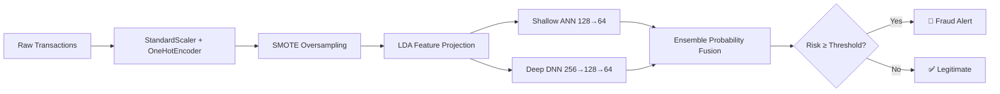

# 🛒 E-Commerce Transaction Fraud Detection System

[](https://share.streamlit.io/)
[](https://www.python.org/)
[](https://scikit-learn.org/)
[](https://imbalanced-learn.org/)

A hybrid machine learning fraud analytics platform combining **SMOTE** class balancing, **Linear Discriminant Analysis (LDA)** feature projection, and an **ANN + DNN Neural Ensemble** with an interactive **Streamlit + Plotly** dark-mode dashboard.

---

## ✨ Key Features

- **Hybrid Ensemble Pipeline**: Combines a Shallow ANN `(128 → 64)` and a Deep DNN `(256 → 128 → 64)` trained on SMOTE-balanced, LDA-projected transaction features.
- **Executive Analytics Dashboard**: Real-time KPI cards, hourly fraud rate trends, device & location risk breakdowns, and Category × Payment Method heatmaps.
- **Interactive Real-Time Risk Scoring**: Live transaction predictor with quick scenario presets, Plotly risk gauge, individual ANN/DNN scores, and explainable risk signals.
- **In-App Training & Evaluation**: Re-train the full pipeline directly from the UI and inspect live Confusion Matrix & ROC Curve artifacts.
- **Transaction Monitor**: Filterable, color-coded transaction log with CSV export.

---

## 🏗️ System Architecture



---

## 🚀 Quick Start

```bash
# 1. Install dependencies
pip install -r requirements.txt

# 2. (Optional) Train models on transaction.csv or built-in synthetic data
python train_model.py

# 3. Launch the Streamlit dashboard
streamlit run app.py
```

---

## 📁 Project Structure

```text
├── app.py                     # Professional Streamlit + Plotly dashboard
├── train_model.py             # Hybrid ANN + DNN + SMOTE + LDA training script
├── evaluate_model.py          # Model evaluation & metric plots
├── generate_predictions.py    # Batch prediction generator
├── predict_ensemble.py        # Ensemble batch scoring
├── fix_predictions.py         # Prediction label fixer utility
├── merge_labels.py            # Label merge utility
├── top_fraud.py               # Top high-risk fraud cases exporter
├── utils/
│   └── data_generator.py      # Synthetic e-commerce transaction generator
├── model_artifacts/           # Saved preprocessor, LDA, ANN/DNN models & plots
├── .streamlit/config.toml     # Dark fintech theme configuration
└── requirements.txt           # Python dependencies
```

---

## 📊 Dataset

The original large dataset is hosted on Google Drive:
[Download Dataset](https://drive.google.com/file/d/1UTq2urzXKbjdskdpjVoDqMnfsfIBQ-Vk/view?usp=sharing)

If `transaction.csv` is not present locally, the application automatically generates a realistic synthetic e-commerce dataset so all analytics, training, and real-time prediction features work out-of-the-box.
